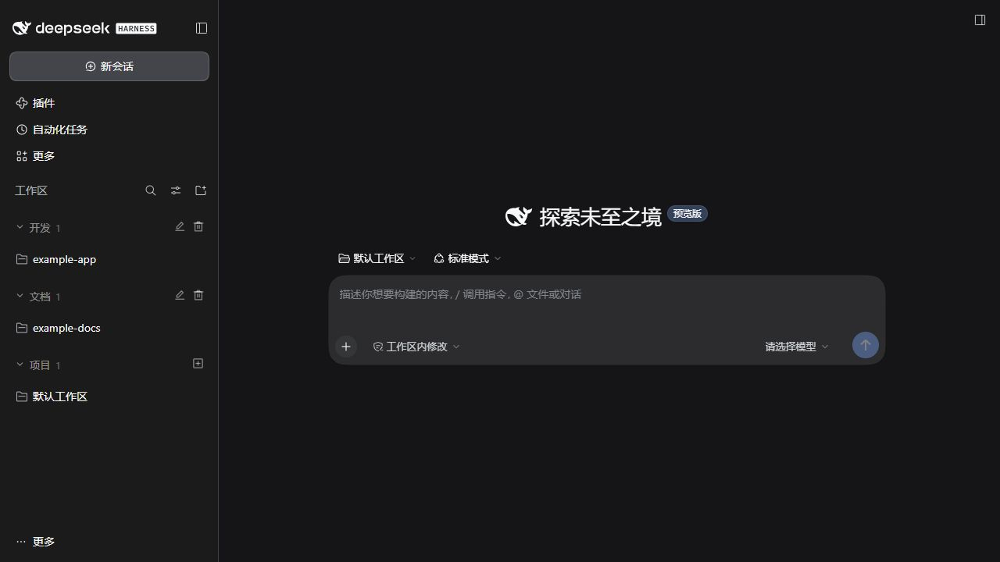
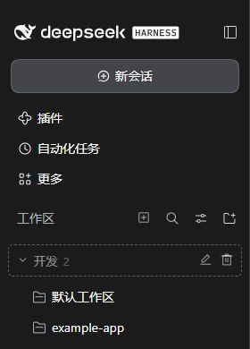
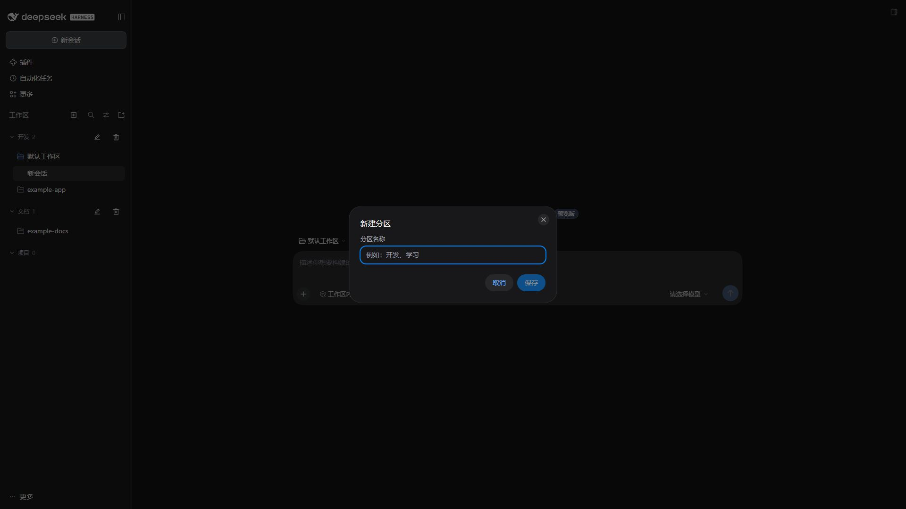
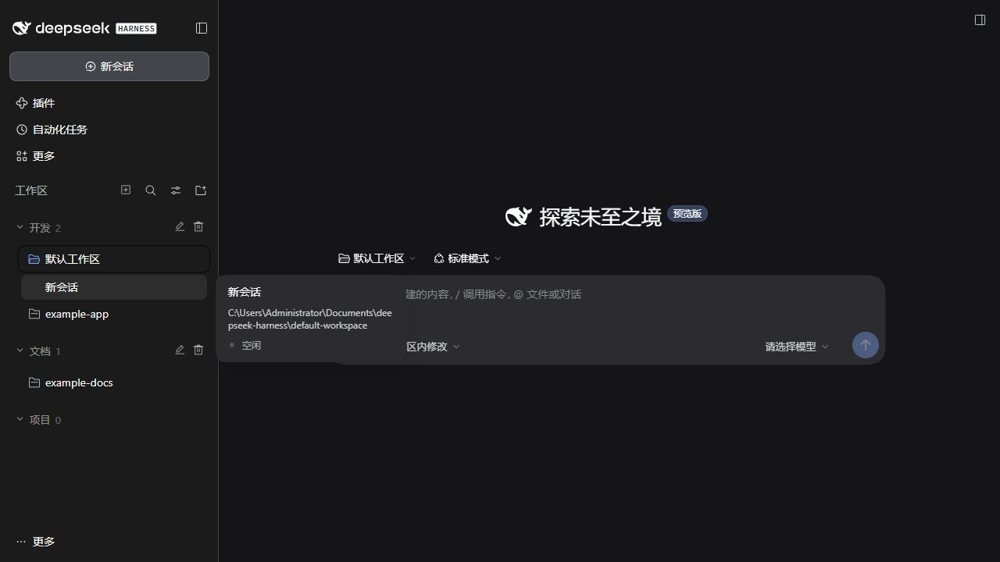

# 工作区分区

`@dsh-plugin/dsh-workspace-group` 为 DSH 侧边栏添加工作区分区，通过右键菜单或拖动整理工作区。









| 功能 | 操作与结果 |
| --- | --- |
| 新建分区 | 点击工作区顶部工具栏中、搜索按钮左侧的加号，输入名称并保存 |
| 右键移动 | 右键工作区，选择“分区”下的目标分区 |
| 新建并移入 | 右键工作区，选择“分区 → 新建分区…” |
| 拖动移动 | 按住工作区标题拖到分区标题、内容或空白区域，松开后保存归属；按 Esc 可取消 |
| 自动折叠 | 拖动已展开的工作区时，自动收起该工作区的会话列表 |
| 折叠分区 | 点击分区标题，收起或展开其中的工作区 |
| 重命名与删除 | 点击分区右侧的编辑或删除图标；删除后工作区返回“项目” |
| 保存与同步 | 分区、归属与折叠状态保存到当前配置档案，其他窗口通过配置事件刷新 |

工作区按宿主 ID 归类，同名目录可以分别放入不同分区。移动归属保留工作区、会话及宿主原有菜单。新建分区名称最多 60 个字符，名称须唯一，“项目”为默认分区的保留名称。

分区内的工作区和会话整体缩进，工作区原有层级和会话缩进继续保留。拖动时会显示工作区预览和目标分区高亮，靠近列表边缘时自动滚动。

界面控件使用 `@dsh-plugin/dsh-ui-components`，随插件内联打包。创建、重命名和删除弹窗在窗口中居中，上下至少保留 120px；超出高度时内容区使用宿主 Scrollbar 滚动，标题和操作按钮保持可见。

## 安装

运行环境：Node.js `>=24.9.0`、DSH `0.2.2-rc.3` 至 `0.2.2`，以及 `@dsh-plugin/dsh-loader >=2.0.0-dev.43799314028`。此目录为插件源码，先构建再从本地路径安装：

```powershell
pnpm install --frozen-lockfile
pnpm build
dsh plugin --profile web add 'C:\Projects\self\dsh-plugins\dsh-workspace-group' '@dsh-plugin/dsh-loader@2.0.0-dev.43799314028'
```

首次安装后刷新 DSH 页面；宿主提示需要重启时，重启 DSH Web 进程。

## 数据与界面

配置由 loader 的 config-api 保存到 `<profile>/config/dsh-workspace-group/config.json`，无需额外 HTTP 路由。写入前读取最新修订号；保存失败时显示错误并保留已保存布局，可再次执行操作。

插件复用宿主的工作区和会话节点，通过 CSS 展示顺序呈现分区。宿主的“按工作区”视图显示完整分区；“工作区树”视图继续遵守父工作区的展开状态，子工作区可见时显示其分区归属。搜索结果和“单一列表”视图继续使用宿主的会话展示。插件启用期间，工作区拖动用于归类，分区内的顺序跟随宿主已有顺序。禁用插件后移除分区标题与展示样式，宿主列表恢复原状；再次启用会读取已保存的分区。

## 开发验证

```powershell
pnpm typecheck
pnpm test
pnpm build
pnpm pack
```

模型测试覆盖分区创建、名称校验、归属替换、默认分区、删除清理和折叠状态。

已在独立的 DSH `0.2.2-rc.3` 实例中验证右键移动、新建并移入、拖动归类、拖动自动折叠、分区折叠、重命名和删除后归属清理；重启后分区数据保留，停用及重新启用时界面正确撤下和恢复。

## npm 自动发布

`.github/workflows/npm-publish.yml` 在 Linux、Windows 和 macOS 上执行类型检查、构建、测试与包内容检查，通过后调用 `dsh-plugins/dsh-npm-publish` 共享发布流程。

| 触发条件 | 发布行为 |
| --- | --- |
| Pull Request 或手动运行 | 执行质量检查 |
| 推送到 `main` | 发布 `0.1.0-dev.<run-id>` 形式的开发版到 `next` |
| 推送 `vX.Y.Z` 标签 | 校验标签与 `package.json` 一致，发布正式版到 `latest` |

发布仓库需公开，并配置 npm Trusted Publisher，调用工作流文件名为 `npm-publish.yml`；也可配置仓库 Secret `NPM_TOKEN`。发布流程会根据当前 GitHub 仓库填写包的 `repository.url`，满足 [npm 来源证明的仓库匹配要求](https://docs.npmjs.com/generating-provenance-statements/)，并核对已发布版本的 `gitHead`。正式版发布后，共享流程向 `main` 回写 `npm-latest.json`，并在基础版本仍与发布版本一致时递增补丁版本号。`package.json` 中的 `version` 保持 `X.Y.Z` 格式。
